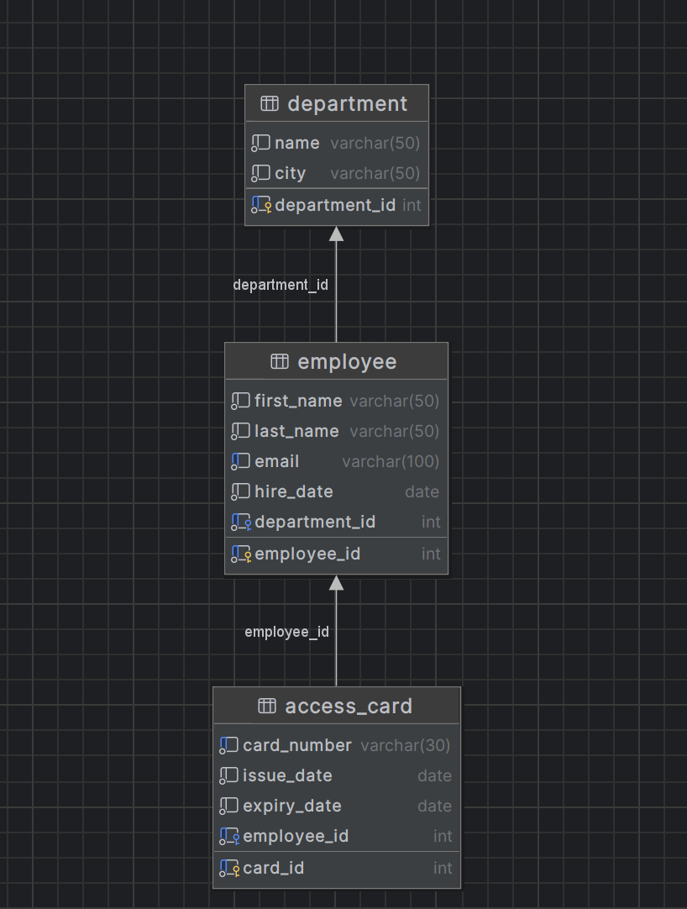
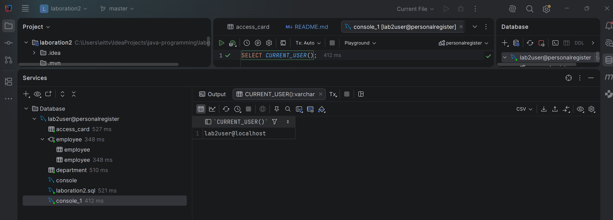
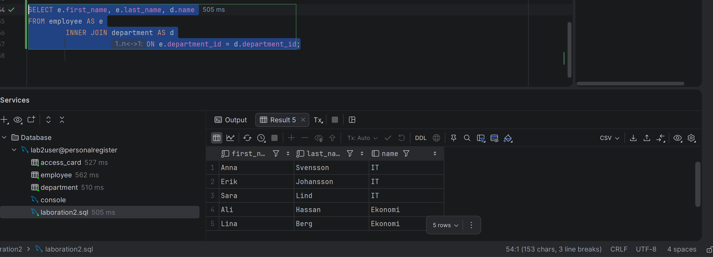
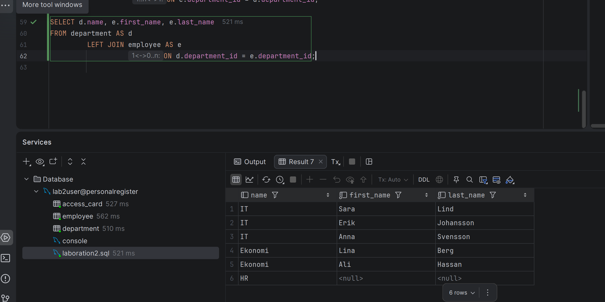
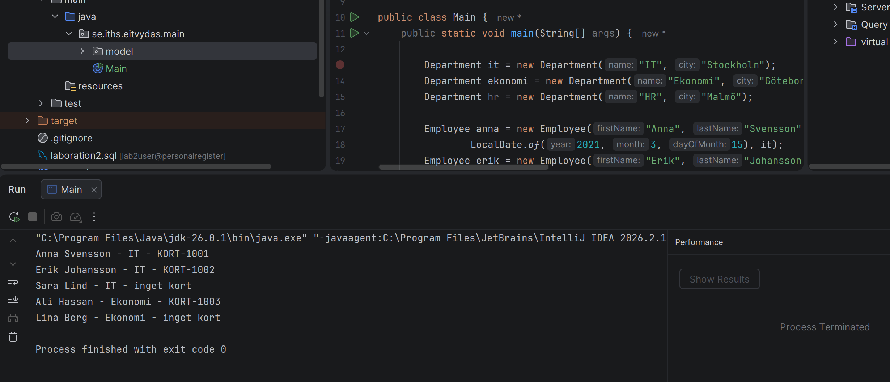

# Laboration 2 - Personalregister

## Steg 1: Entiteter

- **Anställd** (employee)
- **Avdelning** (department)
- **Passerkort** (access_card)

## Steg 2: Attribut

- **Anställd:** förnamn, efternamn, e-post (unik), anställningsdatum
- **Avdelning:** namn, kontorsort
- **Passerkort:** kortnummer (unikt), utfärdandedatum, sista giltighetsdatum

## Steg 3: Relationer

- **Avdelning -Anställd: en-till-många.** En avdelning kan ha flera eller inga anställda. Varje anställd måste tillhöra
  exakt en avdelning.
- **Anställd -Passerkort: valfri en-till-en.** En anställd kan ha högst ett kort, men behöver inte ha något kort. Varje
  kort tillhör exakt en anställd

## Datamodell

Det finns 3 tabeller access_card,department och employee och de kopplas med främmande nycklar i sql, email och
card_number är UNIQUE på grund av att 2 personer kan inte ha samma email och kort nummer. Sen när det kommer till
employee_id i access_card det är UNIQUE för att en anställd kan ha högst ett passerkort.

## Databas och användare

Jag skapade databasen personalregister och en användare som heter lab2user. Den användaren har bara rättigheter till den
databasen.

## G1 - INNER JOIN

Frågan hämtar förnamn, efternamn och avdelnings namn genom att koppla ihop employee och department, det görs med ON där
employee.department_id matchas med department.department_id. Eftersom det är INNER JOIN så visas det bara rader som har
en matchning i båda tabeller. HR är inte där eftersom den saknar anställda.

## G2 - LEFT JOIN

Den hämtar också namn, efternamn och avdelnings namn men nu står department efter FROM eftersom vi vill visa alla
avdelningar. Eftersom det är en LEFT JOIN så behålls alla rader från vänstra tabellen även om det inte finns nån
matchning på höger sida. Resultatet är då 6 rader 5 rader anställda med deras avdelning och en rad för HR. Men eftersom
HR saknar anställda så visas det NULL i kolumnerna förnamn och efternamn.

## G3 - Java-klasser

Varje tabell i databasen blev en klass i java. Kolumnerna blev privata fält och id-kolumnerna blev Integer eftersom de
kan vara null innan objekten sparas. Relationer representeras med objektreferenser istället för främmande nycklar, som
till exempel i databasen så har employee en kolumn för department_id men i Java fick den ett helt Department objekt
istället. Själva avdelningen skickas till in i konstruktorn för att varje anställd måste ha en avdelning. När det kommer
till passerkortet så är det valfritt, så Employee har ett fält AccessCard som kan också vara null. Passerkortet skickas
inte in när själva anställd skapas, eftersom inte alla har ett kort. Det fixar man i efterhand med setAccessCard ()
metod. Det för att det bara finns ett fält där en anställd kan ha högst bara ett kort exakt som UNIQUE i databasen.
Själva kopplingarna går bara åt ett håll från Employee till avdelningen och kortet. Det därför Department eller
AccessCard har ingen koppling tillbaka. I själva Main så skapas objekten med samma testdata som i databasen och en loop
skriver ut varje anställd med deras avdelning och kort om de har en. Också innan själva kortnummer skrivs ut så
kontrolleras det att kortet är inte null.

## Så startar du programmet

Öppna projekten och kör själva Main.java i paketet se.iths.eitvydas.main. Programmet skriver ut alla anställda med
avdelning och passerkort om det inte är null.

